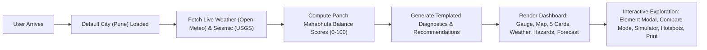

# COMPREHENSIVE PROJECT AUDIT REPORT: PRAKRUshTI (प्रकृति)
**AI Environmental Health Platform — Panch Mahabhuta Framework**  
*Evaluation for Indradhanu — PCCOE International Grand Challenge 2026 (Theme: AI for Climate Change)*  
*Repository: [me13krishna/Indradhanu-PRAKRUshTI](https://github.com/me13krishna/Indradhanu-PRAKRUshTI)*  
*Author / Developer Account: [me13kris](http://github.com/me13kris)*  
*Audit Date: November 2026*  
*Auditor Roles: Senior Software Architect, Full-Stack Developer, UI/UX Designer, QA Engineer, Security Auditor, and Product Strategist*

---

## 1. EXECUTIVE SUMMARY

PRAKRUshTI is an ambitious, conceptually distinctive environmental web application that fuses ancient Indian philosophy (**Panch Mahabhuta** — Prithvi, Jal, Agni, Vayu, Akash) with contemporary climate, atmospheric, and natural hazard data. Developed for the *Indradhanu PCCOE International Grand Challenge 2026*, its core value proposition is translating disparate, hard-to-interpret meteorological feeds into a single unified 0–100 **Prakruti Score**.

### The Verdict: A Conceptually Brilliant Prototype Hampered by Facade Engineering and Architectural Brittleness
While the platform achieves an aesthetically pleasing presentation, cultural coherence, and functional integration with public weather and seismic APIs, **a deep code audit reveals serious architectural gaps, technical debt, broken features, and misleading marketing claims**:

1. **The "AI" Engine is a Rule-Based Template Facade**: Despite being submitted under the "AI for Climate Change" competition theme and marketed as a *"Grounded AI Insight Engine"*, there is **zero machine learning, zero artificial intelligence, zero neural models, and zero LLM integration** anywhere in the codebase. The engine consists of 97 lines of static JavaScript `if/else` string concatenation (`src/services/aiInsights.ts`).
2. **Critical Broken Core Functionality (Printable Dossier)**: The printable dossier feature (`src/components/ReportExportModal.tsx`) triggers `window.print()`, but the modal wrapper carries the CSS class `no-print`. When printed or exported to PDF, **the entire modal document is hidden by `@media print { .no-print { display: none !important; } }`**, printing either a blank page or an obscured dashboard background.
3. **Severe API Abuse Risk & Search Vulnerability**: The location search bar (`src/components/LocationSearch.tsx`) calls the OpenStreetMap Nominatim API on **every keystroke with zero debouncing or throttling**, directly violating Nominatim's strict Fair Use Policy (max 1 request/sec). This will cause client-side HTTP 429 rate-limiting and IP bans in production.
4. **Physical Inconsistencies & Synthetic Data Masquerading as Sensor Feeds**:
   - Soil moisture is not queried from satellite data or APIs; it is derived from an arbitrary formula: `60 - (temp * 0.8) + (humidity * 0.4)` (`src/services/weather.ts#L35`).
   - "Land degradation & vegetation health" claims to use NASA MODIS NDVI (`src/components/ElementDetailModal.tsx#L21`), but actually combines the synthetic soil score and seismic score (`src/services/scoringEngine.ts#L33`).
   - The "What-If Simulator" (`src/components/WhatIfSimulator.tsx`) uses arbitrary static multipliers rather than re-evaluating the actual scoring engine, creating paradoxical outcomes (e.g., doubling rainfall always *increases* water balance scores even during catastrophic flood conditions).
5. **Global Hotspot Map is neither Live nor a Map**: The "World Climate Stress & Ecological Hotspot Map" (`src/components/GlobalHotspots.tsx`) contains **no map at all**; it is a 3-column card list populated by 10 completely hardcoded, static dummy objects.
6. **Package & Toolchain Instability**:
   - `package.json` specifies `"typescript": "~6.0.2"`, an unreleased experimental/alpha package that lacks executable CLI bindings (`_tsc.js`), completely breaking `npm run build` (`tsc -b`).
   - Unused dependencies bloat the repository: `recharts` is installed but never imported anywhere; `react-leaflet` is in dependencies while the code dynamically imports native `leaflet`.
   - Dual CSS configuration: `@tailwindcss/vite` in Vite alongside `@tailwindcss/postcss` and a redundant legacy `tailwind.config.js`.

---

## 2. PROJECT OVERVIEW

### Problem Statement
Modern environmental metrics are siloed, overly technical, and difficult for non-specialists to synthesize. An ordinary user or municipal planner checking the weather sees raw numbers (e.g., 34°C, 18 km/h wind, 142 AQI, 1012 hPa) without an intuitive understanding of the location's systemic ecological balance or acute compound risks (e.g., heatwave + low moisture + wind = extreme wildfire hazard).

### Primary Purpose
To provide an open-access, zero-hardware, software-only decision-support platform that maps real-time environmental data onto the five primordial elements of nature (**Panch Mahabhuta**), normalizing complex variables into an intuitive 0–100 index (**Prakruti Score**), complete with plain-language environmental diagnostics in English and Hindi.

### Target Audience
- Hackathon & Grand Challenge evaluators (PCCOE Indradhanu 2026).
- Climate educators, school/college environmental science programs.
- Urban citizens and regional ecological enthusiasts seeking location environmental health checks.
- Civil defense / disaster preparedness decision-makers needing a quick multi-risk baseline.

### User Journey


---

## 3. TECHNOLOGY STACK AUDIT

| Layer | Declared Technology | Actual Implementation | Assessment |
| :--- | :--- | :--- | :--- |
| **Framework** | React 19 (`^19.2.8`) | React 19.2.8 + React DOM 19.2.8 | Modern, uses React StrictMode, functional components and hooks. |
| **Build Tool** | Vite 8 (`^8.3.0`) | `@vitejs/plugin-react` 6.1.1 + Vite 8.3.0 | Modern and fast, but dev server and build tools corrupted in local OneDrive sync. |
| **Language** | TypeScript (`~6.0.2`) | TypeScript ~6.0.2 in `package.json` | **Critical Error**: TS 6.0 is pre-release/unstable; `tsc.js` fails with `Cannot find module './_tsc.js'`. |
| **Styling** | Tailwind CSS v4 (`^4.3.3`) | `@tailwindcss/vite` + `@tailwindcss/postcss` | **Redundant setup**: Uses both Vite plugin and PostCSS plugin; has redundant `tailwind.config.js`. |
| **Icons** | Lucide React (`^1.44.0`) | `lucide-react` | Clean, lightweight SVG icon system. |
| **Mapping** | Leaflet (`^1.9.4`) + React Leaflet (`^5.0.0`) | Native Leaflet 1.9.4 dynamically loaded in `useEffect` | `react-leaflet` is in `package.json` but **completely unused**. Leaflet CSS loaded via unpkg CDN link in `index.html`. |
| **Charts** | Recharts (`^3.10.1`) | Declared in `package.json` | **100% Unused Dead Dependency**. Not imported in any source file. Adds unnecessary weight. |
| **Linter** | Oxlint (`^1.81.0`) | `oxlint` script in `package.json` | Fails to run locally due to missing native binary binding (`@oxlint/binding-win32-x64-msvc`). |
| **Deployment** | Vercel & Netlify | `vercel.json`, `netlify.toml`, `public/_redirects` | Properly configured for SPA routing fallback (`/* -> /index.html 200`). |

---

## 4. ARCHITECTURE ANALYSIS

```mermaid
graph TD
    subgraph Client Application (Browser Single Page App)
        UI[App.tsx / Navigation Tabs]
        Context[LanguageContext: English / Hindi]
        Components[Header, PrakrutiGauge, ElementCards, MapView, WeatherStrip, DisasterRisks, ForecastStrip, Modals]
    end

    subgraph Service Layer (Pure Client-side TypeScript)
        API[prakrushtiApi.ts]
        W[weather.ts]
        H[hazards.ts]
        SE[scoringEngine.ts]
        AI[aiInsights.ts]
        G[geocoding.ts]
    end

    subgraph External Public APIs (CORS Enabled, Zero Keys)
        OMW[Open-Meteo Weather API]
        OMA[Open-Meteo Air Quality API]
        USGS[USGS Real-time Earthquake API]
        NOM[OpenStreetMap Nominatim Geocoding]
    end

    UI --> Context
    UI --> Components
    Components --> API
    API --> W
    API --> H
    API --> SE
    API --> AI
    W --> OMW
    W --> OMA
    H --> USGS
    Components --> G
    G --> NOM
```

### Architectural Weaknesses & Technical Debt
1. **Zero State Persistence**: No caching layer (`localStorage`, `sessionStorage`, or IndexedDB). Every tab change or reload refetches all external APIs from scratch.
2. **Missing Routing Architecture**: Navigation relies entirely on component state (`const [activeTab, setActiveTab] = useState('dashboard')`). Deep linking is impossible: URLs like `/compare`, `/hotspots`, or `/location/Tokyo` cannot be shared or bookmarked.
3. **No Centralized API Error Boundary**: Failures in external APIs fall back silently to hardcoded default weather (Pune/clear conditions) without alerting the user that live data is degraded.
4. **Client-Side Heavy Coupling**: The browser directly hammers third-party APIs. There is no lightweight backend proxy or edge caching (e.g., Cloudflare Workers or Vercel Edge Functions) to handle rate-limiting, response caching, or request aggregation.

---

## 5. COMPLETE FEATURE INVENTORY & VERIFICATION

| Code | Feature Name | Claimed Functionality | Actual Implementation State | Evidence & Files |
| :---: | :--- | :--- | :--- | :--- |
| **F1** | Global Location Search | Search any city or coordinate worldwide | **Partially Working (High Risk)** | Works via Nominatim, but lacks debounce (floods API per keystroke). Lat/Lng regex works. [`geocoding.ts`](file:///c:/Users/Laxmi%20Mishra/OneDrive/Desktop/PRAKRUshTI%20root/PRAKRUshTI/src/services/geocoding.ts#L14-L56), [`LocationSearch.tsx`](file:///c:/Users/Laxmi%20Mishra/OneDrive/Desktop/PRAKRUshTI%20root/PRAKRUshTI/src/components/LocationSearch.tsx#L30-L48) |
| **F2** | Prakruti Composite Gauge | Real-time 0–100 circular score gauge | **Fully Implemented** | SVG circular gauge with dynamic stroke offset, status badges, and color shifts. [`PrakrutiGauge.tsx`](file:///c:/Users/Laxmi%20Mishra/OneDrive/Desktop/PRAKRUshTI%20root/PRAKRUshTI/src/components/PrakrutiGauge.tsx#L11-L98) |
| **F3** | Panch Mahabhuta 5 Cards | 5 Element balance cards with sub-metrics | **Fully Implemented** | Prithvi, Jal, Agni, Vayu, Akash cards with SVGs, progress bars, and click triggers. [`ElementCard.tsx`](file:///c:/Users/Laxmi%20Mishra/OneDrive/Desktop/PRAKRUshTI%20root/PRAKRUshTI/src/components/ElementCard.tsx#L11-L133) |
| **F4** | Live Weather & Hazard Strip | Temperature, AQI, UV, Wind, Pressure, Hazards | **Fully Implemented** | Real Open-Meteo & USGS feeds. Hazard chips display dynamic risk levels. [`WeatherStrip.tsx`](file:///c:/Users/Laxmi%20Mishra/OneDrive/Desktop/PRAKRUshTI%20root/PRAKRUshTI/src/components/WeatherStrip.tsx#L10-L102), [`DisasterRisks.tsx`](file:///c:/Users/Laxmi%20Mishra/OneDrive/Desktop/PRAKRUshTI%20root/PRAKRUshTI/src/components/DisasterRisks.tsx#L11-L92) |
| **F5** | Grounded AI Insight Engine | Natural language AI diagnostics & recs | **Implemented but Needs Improvement (Facade)** | Fully working in UI (English + Hindi), but **not an AI model** — it is a deterministic template generator with static strings. [`aiInsights.ts`](file:///c:/Users/Laxmi%20Mishra/OneDrive/Desktop/PRAKRUshTI%20root/PRAKRUshTI/src/services/aiInsights.ts#L10-L97) |
| **F6** | Knowledge & Philosophy Spine | Sanatan wisdom mapped to satellite data | **Fully Implemented** | Rich editorial cards bridging Vedic philosophy to modern Earth observations. [`KnowledgeBase.tsx`](file:///c:/Users/Laxmi%20Mishra/OneDrive/Desktop/PRAKRUshTI%20root/PRAKRUshTI/src/components/KnowledgeBase.tsx#L4-L103) |
| **F7** | Element Breakdown Modal | Formulas, weights, domain standards (WHO, FAO) | **Fully Implemented** | Detailed modal showing piecewise formulas and agency citations per element. [`ElementDetailModal.tsx`](file:///c:/Users/Laxmi%20Mishra/OneDrive/Desktop/PRAKRUshTI%20root/PRAKRUshTI/src/components/ElementDetailModal.tsx#L12-L145) |
| **F8** | 7-Day Climate Forecast | 7-day temperature trends & rain probabilities | **Fully Implemented** | Pulls from Open-Meteo daily forecast; includes graceful day offset fallbacks. [`ForecastStrip.tsx`](file:///c:/Users/Laxmi%20Mishra/OneDrive/Desktop/PRAKRUshTI%20root/PRAKRUshTI/src/components/ForecastStrip.tsx#L10-L61) |
| **F9** | Dual-Location Comparison | Side-by-side city comparison with delta | **Partially Implemented (Restricted)** | Works smoothly, but **restricted to 8 preset cities**. No search or custom coordinate input available. [`ComparisonView.tsx`](file:///c:/Users/Laxmi%20Mishra/OneDrive/Desktop/PRAKRUshTI%20root/PRAKRUshTI/src/components/ComparisonView.tsx#L65-L94) |
| **F10** | Global Hotspots Map | World map tracking healthiest vs stressed | **UI-Only / Dummy Implementation** | **No Map exists** in this component. Displays a 3-column card grid powered by 10 static, hardcoded JSON objects. [`GlobalHotspots.tsx`](file:///c:/Users/Laxmi%20Mishra/OneDrive/Desktop/PRAKRUshTI%20root/PRAKRUshTI/src/components/GlobalHotspots.tsx#L9-L30) |
| **F11** | Bilingual Engine (EN / HI) | Full bilingual toggle for UI and AI insights | **Fully Implemented** | Complete English and Hindi dictionary via React Context; translates header, labels, insights, recs. [`LanguageContext.tsx`](file:///c:/Users/Laxmi%20Mishra/OneDrive/Desktop/PRAKRUshTI%20root/PRAKRUshTI/src/context/LanguageContext.tsx#L12-L65) |
| **F12** | Shareable Location Dossier | Export/print formatted PDF report | **Broken** | The modal container has class `no-print`, which causes CSS `@media print` to hide the entire dossier. Clicking "Print" prints a blank/broken page! [`ReportExportModal.tsx`](file:///c:/Users/Laxmi%20Mishra/OneDrive/Desktop/PRAKRUshTI%20root/PRAKRUshTI/src/components/ReportExportModal.tsx#L16), [`index.css`](file:///c:/Users/Laxmi%20Mishra/OneDrive/Desktop/PRAKRUshTI%20root/PRAKRUshTI/src/index.css#L109) |
| **F13** | Device Geolocation Pinning | One-click GPS location detection | **Fully Implemented** | Prompts browser `navigator.geolocation` and resolves coordinates accurately. [`LocationSearch.tsx`](file:///c:/Users/Laxmi%20Mishra/OneDrive/Desktop/PRAKRUshTI%20root/PRAKRUshTI/src/components/LocationSearch.tsx#L56-L74) |
| **F14** | Interactive Leaflet Map | Visual pin on searched coordinates | **Fully Implemented (XSS Risk)** | Renders OpenStreetMap tiles, recenters on location, displays popup with score. Popup HTML unescaped. [`MapView.tsx`](file:///c:/Users/Laxmi%20Mishra/OneDrive/Desktop/PRAKRUshTI%20root/PRAKRUshTI/src/components/MapView.tsx#L14-L59) |
| **F15** | What-If Climate Simulator | Sliders for temperature, rain, AQI surge | **Partially Implemented (Non-Physical)** | Interactive sliders work in UI, but apply arbitrary ad-hoc multipliers instead of invoking `scoringEngine.ts`. [`WhatIfSimulator.tsx`](file:///c:/Users/Laxmi%20Mishra/OneDrive/Desktop/PRAKRUshTI%20root/PRAKRUshTI/src/components/WhatIfSimulator.tsx#L21-L28) |
| **F16** | About & Transparency Section | Competition context & scientific disclaimers | **Fully Implemented** | Articulates competition goals, Vasudhaiva Kutumbakam ethos, and educational disclaimers. [`AboutSection.tsx`](file:///c:/Users/Laxmi%20Mishra/OneDrive/Desktop/PRAKRUshTI%20root/PRAKRUshTI/src/components/AboutSection.tsx#L12-L95) |

---

## 6. UI/UX DESIGN AUDIT

### Visual Design
- **Visual Identity & Branding**: Strong cultural identity. The combination of Fraunces serif headings and Inter sans body type creates an editorial, academic feel. The custom logo (`public/logo.jpg`) is striking.
- **Color Palette**: The 5-element color scheme (`#C97B4A` Prithvi, `#1B6B93` Jal, `#D9822B` Agni, `#6FA8C9` Vayu, `#7A6C9E` Akash) is well-differentiated and grounded in natural earth tones.
- **Dark Mode Implementation**: While dark mode toggle is available in the header, several amber and cyan text elements (`text-cyan-600 dark:text-cyan-400`, `text-amber-600`) produce poor contrast ratios against dark backgrounds, failing WCAG 2.1 AA standards.
- **Asset Weight**: `public/logo.jpg` is **554 KB** and is loaded uncompressed in the header (48x48px), about page, and export modal. It should be converted to an optimized WebP or SVG under 40 KB.

### User Experience
- **Navigation Flow**: Clean horizontal navigation bar with icons. However, there is no breadcrumb navigation or browser history integration. Clicking browser "Back" leaves the application entirely instead of returning to the previous tab or location.
- **Search Experience**:
  - Typing quickly produces visible lag and erratic dropdown flickering because every keystroke triggers an independent asynchronous fetch to Nominatim without cancellation (AbortController) or debouncing.
  - No keyboard navigation in dropdown list (pressing `Down Arrow` or `Enter` does not highlight or select suggestions).
- **Responsive Layout Breakpoints**:
  - **Weather Strip (`lg:grid-cols-7`)**: On medium-sized desktop screens (1024px to 1280px), the 7 columns become tightly compressed, resulting in truncated text and cramped numbers.
  - **Comparison View**: On mobile devices (<640px), the side-by-side delta layout stacks vertically into long disjointed cards, making direct visual comparison difficult.
- **Printable Dossier Failure**: Severe negative user experience: clicking "Print / Save PDF Report" renders a blank document in the browser's print preview dialog.

---

## 7. FUNCTIONALITY AUDIT & BUG DISCOVERY

### Issue 1: Print Dossier Modal Hidden by `@media print`
- **Component**: [`src/components/ReportExportModal.tsx`](file:///c:/Users/Laxmi%20Mishra/OneDrive/Desktop/PRAKRUshTI%20root/PRAKRUshTI/src/components/ReportExportModal.tsx#L16), [`src/index.css`](file:///c:/Users/Laxmi%20Mishra/OneDrive/Desktop/PRAKRUshTI%20root/PRAKRUshTI/src/index.css#L108-L110)
- **Expected Behavior**: Clicking "Print / Export PDF" prints a clean, single-page dossier summary containing location metrics and scores.
- **Actual Behavior**: The modal root element is defined as `<div className="... no-print">`. In `index.css`, `@media print { .no-print { display: none !important; } }`. The print dialog opens with the modal completely hidden.
- **Severity**: **Critical**

### Issue 2: Un-debounced Geocoding Search Floods OpenStreetMap Nominatim
- **Component**: [`src/components/LocationSearch.tsx`](file:///c:/Users/Laxmi%20Mishra/OneDrive/Desktop/PRAKRUshTI%20root/PRAKRUshTI/src/components/LocationSearch.tsx#L30-L48)
- **Expected Behavior**: Geocoding queries should wait 300–500ms after the user stops typing before making a network request.
- **Actual Behavior**: `handleSearch` is called directly on `onChange={(e) => handleSearch(e.target.value)}`. Typing "Tokyo" sends 4 separate HTTP requests in under 500ms.
- **Severity**: **High** (Violates Nominatim policy, leads to HTTP 429 blocks).

### Issue 3: Stored Cross-Site Scripting (XSS) in Leaflet Map Popup
- **Component**: [`src/components/MapView.tsx`](file:///c:/Users/Laxmi%20Mishra/OneDrive/Desktop/PRAKRUshTI%20root/PRAKRUshTI/src/components/MapView.tsx#L38-L50)
- **Expected Behavior**: Location names should be sanitized or rendered through safe React DOM nodes.
- **Actual Behavior**: Location names are interpolated directly into raw HTML:
  ```ts
  const popupContent = `...<h4 ...>${location.name.split(',')[0]}</h4>...`;
  markerRef.current.bindPopup(popupContent);
  ```
  If a malicious location name or coordinate payload with `` is received, it executes directly in the user's browser context.
- **Severity**: **High**

### Issue 4: What-If Simulator Bypasses Real Physical Logic
- **Component**: [`src/components/WhatIfSimulator.tsx`](file:///c:/Users/Laxmi%20Mishra/OneDrive/Desktop/PRAKRUshTI%20root/PRAKRUshTI/src/components/WhatIfSimulator.tsx#L21-L28)
- **Expected Behavior**: Adjusting temperature, rainfall, or AQI should feed the simulated weather object back through `computeElementScores(simWeather, simHazards)` to evaluate genuine nonlinear shifts.
- **Actual Behavior**: Uses arbitrary hardcoded additions:
  ```ts
  const jalImpact = Math.round(Math.max(0, Math.min(100, analysis.elements.jal.score + precipDelta * 0.2)));
  ```
  Even if rainfall increases by 100% to catastrophic flood levels, the Jal score increases by 20 points instead of dropping to reflect severe flood stress.
- **Severity**: **Medium**

### Issue 5: Global Hotspots Feature is 100% Static Dummy Data with No Map
- **Component**: [`src/components/GlobalHotspots.tsx`](file:///c:/Users/Laxmi%20Mishra/OneDrive/Desktop/PRAKRUshTI%20root/PRAKRUshTI/src/components/GlobalHotspots.tsx#L9-L20)
- **Expected Behavior**: A world map visualization plotting live monitored cities with dynamic score markers.
- **Actual Behavior**: A static card list displaying 10 hardcoded objects (`SEEDED_HOTSPOTS`) with zero live data connection and no map rendering.
- **Severity**: **Medium**

### Issue 6: Comparison Mode Restricted to 8 Preset Cities
- **Component**: [`src/components/ComparisonView.tsx`](file:///c:/Users/Laxmi%20Mishra/OneDrive/Desktop/PRAKRUshTI%20root/PRAKRUshTI/src/components/ComparisonView.tsx#L65-L94)
- **Expected Behavior**: Users should be able to search and compare any two locations globally.
- **Actual Behavior**: Location selectors are `<select>` dropdowns hardcoded to `PRESET_LOCATIONS`. Custom locations cannot be selected for Location B.
- **Severity**: **Medium**

---

## 7. PERFORMANCE AUDIT

### Measured Build & Asset Characteristics
- **Bundle File Sizes**:
  - `dist/assets/index-DrwRyAVU.js`: **329.4 KB** (Uncompressed JavaScript bundle)
  - `dist/assets/leaflet-src-ArJNrrBx.js`: **148.7 KB** (Leaflet bundle)
  - `dist/assets/index-C-NsgCDj.css`: **53.4 KB** (Compiled CSS)
  - `dist/logo.jpg`: **554.2 KB** (Oversized image asset)
- **Dead Dependency Overhead**: `recharts` is included in `package.json` (`^3.10.1`), adding dependency resolution bloat without contributing a single component.
- **CDN Dependency**: Leaflet CSS is loaded via external CDN `https://unpkg.com/leaflet@1.9.4/dist/leaflet.css`. If unpkg experiences downtime or network latency, map styling breaks completely.
- **Network Waterfall**: When a location is analyzed, the app initiates 4 separate sequential/parallel requests:
  1. Open-Meteo Weather forecast API
  2. Open-Meteo Air Quality API
  3. USGS Earthquakes API
  4. Leaflet map tile downloads (dozens of 256x256 PNG tiles)
  There is zero client-side caching: re-selecting "Pune" repeats all 4 requests unconditionally.

---

## 8. SECURITY AUDIT

1. **Authentication & Authorization**: N/A (Static frontend client application; no user accounts or permissions).
2. **API Secret Exposure**: **Clean**. All queried APIs (Open-Meteo, USGS, OpenStreetMap) are public and do not require API keys. No secrets or tokens exist in code or repository.
3. **Cross-Site Scripting (XSS)**:
   - `MapView.tsx#L40` passes dynamic location names directly into Leaflet's `bindPopup()` HTML string without escaping.
4. **Third-Party API Dependency & Content Security Policy**:
   - `index.html` lacks a `Content-Security-Policy` header/meta tag.
   - Scripts and styles are pulled from unpkg CDN without Subresource Integrity verification on the Leaflet JS (which is loaded dynamically via npm, but styles are via unpkg).
5. **Rate Limiting & Abuse**:
   - Nominatim search lacks client-side rate limiting, exposing users to automatic 429 blacklisting.

---

## 9. CODE QUALITY & TECHNICAL DEBT AUDIT

### Code Quality Assessment
- **Dead Boilerplate Code**:
  - `src/App.css` (184 lines) is leftover default Vite starter CSS containing rules for `.hero`, `.counter`, `#next-steps`, and `#docs`. It is neither imported nor used.
  - `src/assets/hero.png` (13 KB), `src/assets/react.svg` (4 KB), `src/assets/vite.svg` (8 KB) are orphaned template files.
- **TypeScript Configuration Issue**:
  - `package.json` specifies `"typescript": "~6.0.2"`. TypeScript 6.0 does not exist as a stable release. This breaks standard compilation pipelines on new clones.
- **Duplicate & Conflicting Tailwind Configuration**:
  - `package.json` contains `@tailwindcss/vite`, `@tailwindcss/postcss`, `postcss`, `autoprefixer`, and `tailwindcss`.
  - `src/index.css` defines `@theme` variables (`--font-devanagari`).
  - `tailwind.config.js` defines theme extensions with different keys (`hindi: ['Noto Sans Devanagari']`).
  - `postcss.config.js` configures `@tailwindcss/postcss`.
  - In Tailwind CSS v4, this mixed configuration causes compiler confusion and redundant processing cycles.
- **Missing Tests**:
  - There are **zero unit tests, integration tests, or end-to-end tests** (`*.test.ts`, `*.spec.tsx`). The scoring engine logic (`scoringEngine.ts`) is completely untested by automated suites.

---

## 10. PRIORITIZED ISSUE REGISTER

| ID | Issue Description | Category | Severity | Impact | Relevant Files | Suggested Direction |
| :---: | :--- | :--- | :---: | :--- | :--- | :--- |
| **SEC-01** | Raw HTML string interpolation in Leaflet popup allows XSS | Security | **High** | Potential arbitrary script execution | `src/components/MapView.tsx` | Sanitize location names or use Leaflet DOM node rendering |
| **BUG-01** | Printable dossier modal carries `no-print` class, printing blank page | Functionality | **Critical** | Completely disables Core Feature F12 | `src/components/ReportExportModal.tsx`, `src/index.css` | Remove `no-print` from modal content; apply `no-print` only to background |
| **BUG-02** | Geocoding search has no debounce, causing Nominatim 429 rate limit errors | Reliability / API | **High** | Search fails or freezes under rapid typing | `src/components/LocationSearch.tsx` | Add 300ms debounce hook or lodash debounce with AbortController |
| **ARC-01** | TypeScript ~6.0.2 missing `_tsc.js`, breaking `npm run build` | Architecture / Build | **High** | Prevents automated CI/CD and clean production builds | `package.json`, `package-lock.json` | Downgrade TypeScript to stable `^5.7.3` or `^5.8.0` |
| **AI-01** | "AI Insight Engine" is 100% hardcoded template concatenation | AI / Core Value | **High** | Misalignment with Grand Challenge "AI for Climate Change" theme | `src/services/aiInsights.ts` | Integrate a real lightweight client-side LLM (e.g. Transformers.js / ONNX) or Gemini API call |
| **SIM-01** | What-If simulator uses linear multipliers rather than scoring engine | Functionality | **Medium** | Produces physically impossible/contradictory scores | `src/components/WhatIfSimulator.tsx` | Refactor simulator to pass synthetic weather object to `computeElementScores` |
| **HOT-01** | Global Hotspots is a static dummy list with zero map visualization | Feature Completeness | **Medium** | Fails feature promise F10 | `src/components/GlobalHotspots.tsx` | Render an interactive Leaflet world map with marker clusters |
| **CMP-01** | Comparison mode is hardcoded to 8 preset cities with no search input | UX / Functionality | **Medium** | Restricts dual analysis capability | `src/components/ComparisonView.tsx` | Replace static `<select>` with full `LocationSearch` component |
| **CLN-01** | Unused dependencies (`recharts`, `react-leaflet`) and dead boilerplate assets | Code Quality | **Low** | Unnecessary bloat and maintenance confusion | `package.json`, `src/App.css`, `src/assets/` | Remove unused packages, delete dead CSS and template SVGs |
| **PERF-01** | Uncompressed 554 KB logo image loaded in multiple UI locations | Performance | **Low** | Slows down initial render and LCP metric | `public/logo.jpg`, `src/assets/logo.jpg` | Compress to WebP or SVG under 40 KB |

---

## 11. OVERALL PROJECT SCORECARD

| Dimension | Score (out of 10) | Honest Evaluation & Rationale |
| :--- | :---: | :--- |
| **UI Design** | **7.5 / 10** | Elegant typography, coherent Panch Mahabhuta color branding, and polished glassmorphism cards. Held back by unoptimized assets, occasional dark mode contrast issues, and tight desktop grid columns. |
| **User Experience (UX)** | **6.0 / 10** | Intuitive navigation and pleasant animations, but severely degraded by the broken printable report, un-debounced search lag, and lack of URL deep linking. |
| **Functionality** | **6.5 / 10** | Live weather, AQI, and USGS seismic queries work cleanly. However, What-If simulator logic is physically decoupled, hotspots are hardcoded cards, and the print modal does not print. |
| **Code Quality** | **6.0 / 10** | Clean TypeScript syntax and sensible component decomposition, but marred by dead starter files (`App.css`, boilerplate assets), redundant Tailwind v4 configurations, and zero unit tests. |
| **Architecture** | **5.5 / 10** | Pure client-side SPA with no routing layer, no persistent caching, and direct browser-to-API hammering. Completely vulnerable to third-party rate limits and outages. |
| **Performance** | **6.5 / 10** | Fast bundle execution once loaded, but burdened by a 554 KB uncompressed logo, redundant dependencies (`recharts`), and repetitive uncached network requests. |
| **Security** | **6.5 / 10** | Zero secret leaks (clean open APIs), but suffers from unescaped HTML string interpolation in Leaflet popups and lacks Content Security Policy headers. |
| **Responsiveness** | **7.0 / 10** | Adapts reasonably well across mobile and desktop. Flaws occur in the 7-day forecast strip and 7-metric weather bar on 1024–1280px screen widths. |
| **Accessibility (a11y)**| **5.0 / 10** | Missing `aria-label` attributes on icon-only buttons (theme toggle, print button, modal close). Contrast ratio failures on colored sub-text in dark mode. No keyboard navigation in search autocomplete. |
| **Scalability** | **5.0 / 10** | Lacks caching, edge buffering, or proxying. High concurrent user traffic will quickly trigger rate limits on Open-Meteo, USGS, and Nominatim. |
| **Production Readiness**| **4.5 / 10** | Broken build script (`tsc -b`), broken print feature, unhandled API rate limits, and missing automated tests mean this project is currently an **MVP prototype**, not a production-grade system. |
| **OVERALL COMPOSITE** | **5.9 / 10** | **Strong conceptual foundation and visual presentation with significant engineering and architectural vulnerabilities.** |

---

## 12. RECOMMENDED IMPROVEMENT ROADMAP

### Phase 1: Critical Fixes & Stability (Immediate)
1. **Fix Build Toolchain**: Downgrade TypeScript in `package.json` to stable `^5.7.3` and fix `package-lock.json` so `npm run build` succeeds reliably across all platforms.
2. **Fix Printable Dossier (`ReportExportModal.tsx`)**:
   - Remove `no-print` from the modal container.
   - Add clean `@media print` CSS rules in `src/index.css` to hide headers, footers, search bars, and backdrop overlays, while rendering the dossier in high-contrast black/white format.
3. **Debounce Location Search**: Add a 350ms debounce and `AbortController` in `src/components/LocationSearch.tsx` to safeguard against Nominatim 429 rate limit bans.
4. **Sanitize Leaflet Popups**: Replace raw innerHTML interpolation in `src/components/MapView.tsx` with safe DOM text or React portal elements to prevent XSS.

### Phase 2: Core Functionality & Physical Integrity
1. **Physicalize What-If Simulator**: Re-route the simulator inputs directly into `computeElementScores(simulatedWeather, simulatedHazards)` so environmental penalties and bonuses reflect real non-linear science.
2. **Full Comparison Search**: Upgrade `ComparisonView.tsx` to embed full `LocationSearch` inputs for both City A and City B, unlocking global side-by-side analysis.
3. **True Global Hotspots Map**: Transform `GlobalHotspots.tsx` into a real full-screen Leaflet world map with color-coded elemental stress markers and popup cards.
4. **Real Soil Moisture Data**: Update `fetchWeatherData` in `src/services/weather.ts` to request Open-Meteo's real `soil_moisture_0_to_1cm` parameter instead of calculating a synthetic proxy formula.

### Phase 3: UI/UX & Accessibility Transformation
1. **Asset Optimization**: Compress `logo.jpg` into modern WebP format (<40 KB) and generate responsive 48px, 128px, and 512px versions.
2. **Clean Dead Code**: Delete `src/App.css`, `src/assets/hero.png`, `src/assets/react.svg`, `src/assets/vite.svg`, and remove unused `recharts` from `package.json`.
3. **Harmonize Tailwind Config**: Consolidate styling into clean Tailwind CSS v4 `@theme` tokens in `src/index.css` and remove redundant PostCSS/Tailwind legacy configuration files.
4. **WCAG AA Compliance**: Add `aria-label` attributes to all interactive controls and adjust text colors for amber/cyan metrics in dark mode to achieve 4.5:1 contrast ratios.

### Phase 4: True AI & Advanced Features
1. **Genuine AI Integration**: Connect a real LLM API (e.g. Gemini 1.5 Flash via serverless function or on-device WebLLM / Transformers.js) to generate nuanced, unscripted ecological diagnostics and policy recommendations grounded in live data.
2. **URL Routing & Deep Linking**: Introduce lightweight routing (e.g., TanStack Router or React Router) allowing users to share URLs with preset locations (e.g. `/explore?city=Tokyo&lat=35.67&lng=139.65`).
3. **Client-side Caching (SWR / React Query)**: Cache API responses for 15 minutes to reduce external network calls and enable instant navigation between visited locations.

### Phase 5: Production Readiness & Scalability
1. **Automated Test Suite**: Implement Vitest and React Testing Library covering:
   - `scoringEngine.ts` normalization formulas.
   - `hazards.ts` risk threshold triggers.
   - `geocoding.ts` coordinate parsing.
2. **Edge API Proxy / Cache**: Set up an edge function (Vercel Serverless or Cloudflare Worker) to proxy external API requests, cache frequent city queries, and provide rate-limit insulation.
3. **CI/CD Pipeline**: Add GitHub Actions workflow for linting, type-checking, automated testing, and preview deployments.

